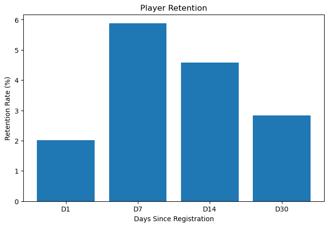

# Mobile Gaming Analytics: Player Retention & A/B Testing

This project analyzes player behavior in a mobile game, focusing on two key areas: **player retention** and **monetization**.

Using registration, login activity, and A/B test data, the analysis measures exact-day retention at D1, D7, D14, and D30 and evaluates the performance of two promotional offers using **Conversion Rate, ARPU, and ARPPU**.

Statistical hypothesis testing is used to determine whether the differences between the control and test groups provide sufficient evidence to support a change in promotional strategy.

## Business Problem

Mobile games depend on both **player engagement** and **monetization** for long-term performance. Understanding whether players return after registration and how they respond to promotional offers can help guide product and marketing decisions.

This project addresses two main business questions:

1. **Player Retention:** How many players return to the game after 1, 7, 14, and 30 days from registration?

2. **Promotional Offer Performance:** Does the new promotional offer (Group B) improve monetization compared with the existing offer (Group A) without negatively affecting the proportion of players who make a purchase?

The goal is to translate player activity and revenue data into actionable insights that can support retention and monetization decisions.

## Dataset

The analysis uses three datasets from the **Gamelytics Mobile Analytics Challenge**:

- **`reg_data.csv`** — Registration data for 1,000,000 players, including the user ID (`uid`) and registration timestamp (`reg_ts`).

- **`auth_data.csv`** — More than 9.6 million player login records, containing the user ID (`uid`) and authentication timestamp (`auth_ts`).

- **`ab_test.csv`** — A/B test data for 404,770 players, including the user ID (`user_id`), revenue generated (`revenue`), and experimental group (`testgroup`).

The registration and authentication datasets are used to analyze player retention, while the A/B test dataset is used to evaluate the impact of different promotional offers on monetization.

## Dataset Access & Reproducibility

This project uses the Gamelytics Mobile Analytics Challenge dataset to analyze player retention, monetization, and A/B testing.

The original datasets are stored locally and are not intended for redistribution until their sharing permissions have been verified.

The Jupyter Notebook contains the analysis code, executed results, retention metrics, statistical tests, and business recommendations, allowing reviewers to examine the methodology and findings.

### How to Reproduce the Analysis

1. Clone the repository:

   ```bash
   git clone https://github.com/jesushr-1/mobile-gaming-analytics.git
   ```

2. Navigate to the project directory:

   ```bash
   cd mobile-gaming-analytics
   ```

3. Install the required dependencies:

   ```bash
   python -m pip install -r requirements.txt
   ```

4. Obtain the original datasets from an authorized source and place them in the `raw/` directory:

   - `reg_data.csv`
   - `auth_data.csv`
   - `ab_test.csv`

5. Open `notebooks/01_data_understanding.ipynb` in Jupyter Notebook or VS Code.

6. Verify the dataset paths and execute the notebook cells in order.

## Methodology

The project was divided into two main analyses:

### Player Retention

- Converted Unix timestamps into calendar dates.
- Connected player registration data with login activity.
- Calculated the number of days between registration and each login.
- Removed duplicate user activity within the same day.
- Calculated exact-day retention for **D1, D7, D14, and D30**.
- Included only players who had enough observation time to reach each retention period.

### Player Retention Visualization



Among the days analyzed, D7 showed the highest retention (5.88%), while D30 recorded 2.83%. These results correspond to specific days following registration and do not represent cumulative retention.

### A/B Testing

- Compared the control group (A) and test group (B) using three monetization metrics:
  - **Conversion Rate**
  - **ARPU (Average Revenue Per User)**
  - **ARPPU (Average Revenue Per Paying User)**
- Used a **two-proportion z-test** to evaluate the difference in conversion rates.
- Used **Welch's t-test** to compare ARPU and ARPPU between the groups.
- Evaluated statistical significance using **α = 0.05**.

## Player retention

Retention was calculated as the percentage of registered players who logged in again on a specific day after their registration.

|  Day after registration  | Retention |
|--------------------------|-----------|
| D1                       | 2,01%     |
| D7                       | 5,88%     |
| D14                      | 4,57%     |
| D30                      | 2,83%     |

**Interpretation:** Among the four days analyzed, D7 showed the highest retention (5.88%). This does not mean that retention increased continuously up to day 7, as each value represents the activity recorded on a specific day rather than the cumulative retention of the players.

## Key Findings

- Exact-day retention was highest at D7 (5.88%) among the analyzed checkpoints.
- Group B increased observed ARPU by 5.3% and ARPPU by 12.7%, but neither increase was statistically significant.
- The conversion rate decreased from 0.9540% in Group A to 0.8906% in Group B, a reduction of 0.0634 percentage points (approximately a 6.6% relative decrease). This difference was statistically significant (p = 0.035), indicating evidence of a lower proportion of players who made purchases in Group B.
- Based on the results, the analysis does not support replacing promotional offer A with offer B.

## Limitations of the analysis

- **Retention:** The analysis was limited to days D1, D7, D14, and D30. The results represent activity on specific days, rather than cumulative retention or the ongoing activity of the players.
- **A/B Testing:** While the results allow for a comparison of metrics between groups A and B, they do not provide sufficient information regarding the duration of the experiment, the user assignment process, or potential external factors.
- **Statistical significance:** The differences observed in ARPU and ARPPU were not statistically significant. Therefore, there is insufficient evidence to claim that offer B improves monetization.
- **Recommendation:** Based on the available evidence, the results do not support replacing offer A with offer B. It would be advisable to validate these findings through further experimentation.